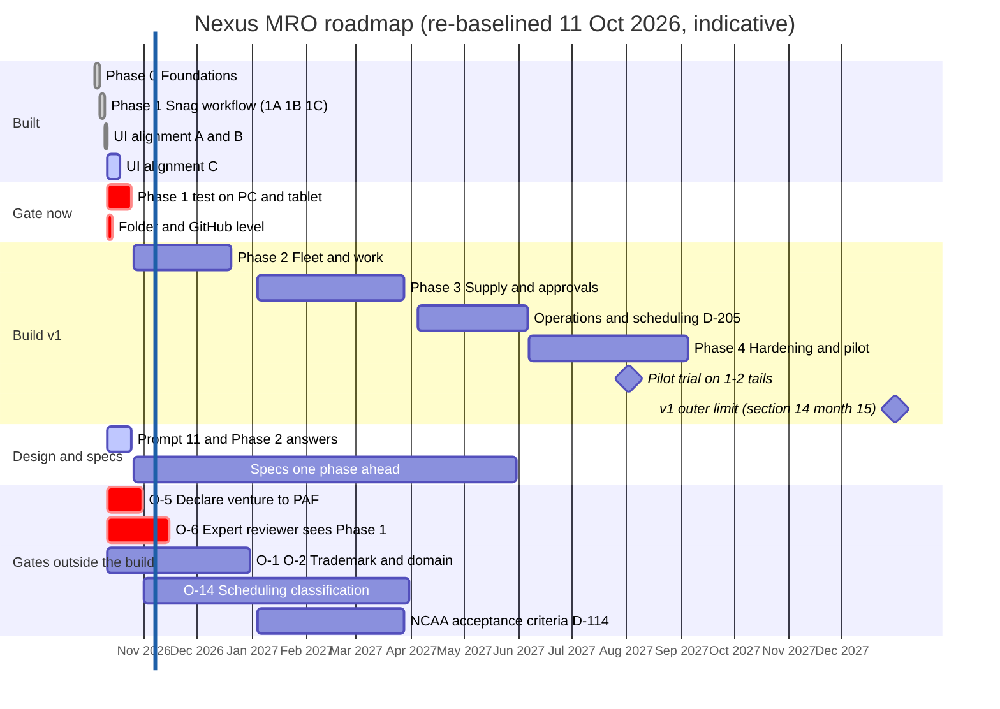
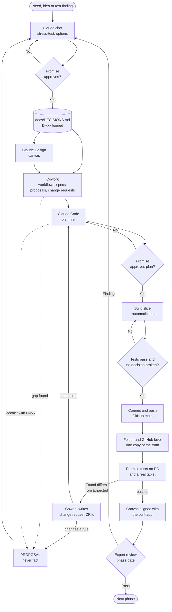
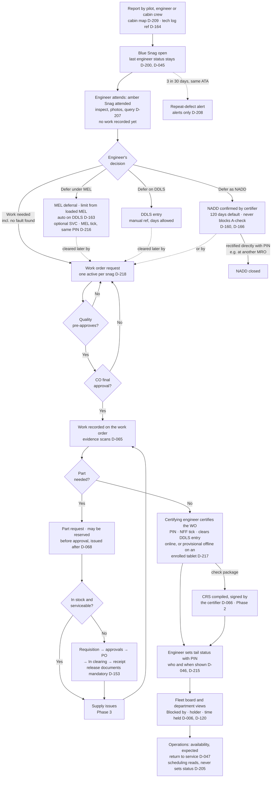

# Nexus MRO — Roadmap and Project Flow

**Status:** DRAFT for Promise's review · **updated 11 Oct 2026** by Cowork (documents lane) · first version 7 Oct 2026
**Source of truth:** `docs/DECISIONS.md` §14 (phases and months) and the decisions cited. This file does not change any decision. The re-baseline in §3 is **PROPOSAL P-RM-1 (revised)**, with P-RM-2 and P-RM-3, until logged.
**Visual version:** `docs/roadmap.html` (same diagrams, rendered)

---

## 1. Where we are (11 Oct 2026)

| Track | Position |
|---|---|
| **Build** | **Phase 0 done** (migrations 0001–0009, 37 tests). **Phase 1 done**: 1A backend (0010–0021, 90 tests at that point), 1B screens (slices 1–4), 1C offline cache, send queue and provisional offline signing on enrolled tablets (0023, D-217). Work-order-first built as **D-218** (0024). UI aligned with the canvas, phases A and B done; **phase C next** |
| **Decisions** | Logged to D-217 in this folder; **D-218 exists on GitHub only** (see §4, R-2). Closed since 7 Oct: O-16 to O-19 (D-200 to D-203). Open: O-1 to O-7, O-9, O-14, O-15, O-20 |
| **Design** | Claude Design canvas: 155 artboards, Prompts 1–10 done; aligned with the built app (GitHub `main`, D-218) on 11 Oct, which covers most of Prompt 11. Status: `docs/design-status.md` |
| **Specs** | Phase 2 spec drafted (`docs/phase2-spec.md`), waiting on Q-P2-1 to Q-P2-9 and P-2.1 to P-2.8. Phase 1 change requests CR-1 to CR-5 all built (`docs/phase1-feedback.md`) |
| **Testing** | Phase 1 **not yet tested by Promise** on the PC and a real tablet (`docs/local-test-script.md`) |
| **Business / legal** | **O-5** (declare the venture to PAF) and **O-6** (expert reviewer) still open |

**Headline:** §14's six-month target (Phase 0 + Phase 1) was met in the first week. The schedule risk raised on 7 Oct is gone. The risk now runs the other way: the build is ahead of testing, review and the PAF declaration (§4).

---

## 2. What changed since 7 Oct

| Change | Effect on the roadmap |
|---|---|
| Phase 0 and Phase 1 built (4–10 Oct) | Roadmap re-baselined on gates instead of months (P-RM-1, revised) |
| **D-214**: core of work orders moved into Phase 1 | Phase 2 keeps CRS and check packages only |
| **D-205**: flight and crew scheduling built **in v1**, after the snag workflow, once O-14 is settled | Phases 5 and 6 are no longer "after v1"; placed by P-RM-2 |
| **D-212**: light blue, yellow, black and white replace navy and teal | Visual version restyled |
| **D-215 to D-218**: PIN for tail status, SVC · MEL tick at deferral, provisional offline signing, work order first | Product flow (§6) redrawn |
| **D-200**: blue "Snag open", amber "Snag attended" | Product flow (§6) |
| Q-P2-7: parts and stores in Phase 2 (CLAUDE.md) or Phase 3 (this file)? | **Still open.** This roadmap keeps Phase 3 until Promise answers |

---

## 3. Roadmap (re-baselined)

**How to read it:** grey = done (actual dates); blue = in progress; white = planned; red = gates outside the build. Planned dates are **indicative** and assume each phase starts only when the one before passes its gate (P-RM-3). §14's months remain the **outer limit**: v1 finished by month 15 (December 2027).

### Phases, status and exit gates

| Phase | Scope | Status | Exit gate |
|---|---|---|---|
| **0 Foundations** | Accounts, roles, privileges, append-only audit, departments and per-user access (D-120 to D-127), 3LC (D-162), aircraft and store registers, settings, one database per operator | **Done** 7 Oct · 37 tests | ✅ No deletes, audit chain, RLS, no self-granting |
| **1 Core workflow** | Snags (D-040, D-200), tail status with PIN (D-215), MEL and DDLS (D-163, D-216), NADD (D-160, D-166), core work orders (D-214, D-218), queries (D-207), repeat defects (D-208), cabin map (D-209), prints, offline signing (D-217) | **Built** 10 Oct · automatic tests per `app/README.md` | ⏳ **Promise's field test on PC and tablet**, then the expert reviewer sees it (P-RM-3) |
| **2 Fleet and work** | Flight records and totals, components by position, due items, check packages and task cards, CRS, ADs and SBs, dashboards, prints (`docs/phase2-spec.md`) | Spec drafted | An A-check package closes with its work order, Quality and CO approval, all tasks certified, findings closed and a compiled CRS |
| **3 Supply and approvals** | Main/Forward stores (D-141, D-142, D-150 to D-153), part request vs requisition/PO (D-145 to D-149), approval chains, cost history, outside-MRO oversight (D-144), workshops (D-018, D-019, O-15) | Designed | Request → requisition → approvals → PO → In clearing → receipt with documents → issue, separation of duties enforced (D-146) |
| **Operations and scheduling** (P-RM-2) | Flight requests, Outstanding missions, fleet roster, crew assignment, flight order (D-205); **crew qualifications engine** (D-080 to D-085), which crew assignment needs | Designed · blocked by **O-14** and O-20 | Scheduling reads availability and never changes a tail status (D-046, D-205); classification rules from O-14 enforced |
| **4 Hardening and pilot** | Notifications, security review, offline testing at scale, trial on 1–2 tails alongside the paper tech log, NCAA acceptance pack (D-114), customer loads own OEM data (D-112) | — | Expert review signed off; trial complete |

### Proposals in this section

| ID | Proposal | Why |
|---|---|---|
| **P-RM-1 (revised)** | Re-baseline §14 on **gates, not months**. §14's months stay as the outer limit (v1 by month 15). Replaces the 7 Oct P-RM-1 and its options A to C, which the build overtook | Phase 0 and 1 took one week instead of six months. Months no longer tell anyone where the project is |
| **P-RM-2** | Build Operations and scheduling (D-205) **after Phase 3 and before Phase 4**, and pull the **crew qualifications engine** (old Phase 5) into it, because crew assignment checks qualification validity (canvas question Q-CR1) | D-205 says "after Phase 1" but gives no slot. Scheduling needs availability (Phase 1), totals (Phase 2) and the O-14 classification rules. It must be in place before the pilot trial |
| **P-RM-3** | **No phase starts until the previous one passes its exit gate**, and from Phase 1 on the gate includes Promise's field test on a real tablet. The expert reviewer sees every phase before the next is built | Keeps the build from getting further ahead of verification (R-1) |

---

## 4. Risks now

| # | Risk | Why it matters | Mitigation |
|---|---|---|---|
| **R-1** | **The build is ahead of verification.** Two phases are built, but none has been tested on a real tablet or seen by an expert reviewer. About 150 decisions were made in one week | Faults found late cost more to fix, and an aviation records system is judged on how it was verified, not how fast it was built | P-RM-3; run `docs/local-test-script.md` before Phase 2 starts; close O-6 |
| **R-2** | **Two copies disagree.** The app on GitHub is newer than this folder, D-218 is not in this folder's `DECISIONS.md`, and the docs written here since 10 Oct are not on GitHub | Each tool reads a different truth. A decision could be broken without anyone seeing it | Bring the folder and GitHub level before anything else is built. One copy, then commit |
| **R-3** | **O-5 is still open while a working system exists.** A serving member is building software aimed at his own unit | Each working feature makes a late declaration harder to explain. It affects the venture and Promise personally | Declare through the proper PAF channel before any demo to anyone at PAF |
| **R-4** | **Work-order-first may push minor faults into NADD** (RW-6 in `workflows/work-order.md`) | Two approvals per minor job tempts people to defer and fix directly | Quality report of NADDs raised and rectified within a short time; repeat-defect alert (D-208) |
| **R-5** | **Scheduling handles classified material** (O-14) | Mission data on the wrong server is a security incident, not a bug | Settle O-14 before any scheduling build (D-205); on-premise only |

---

## 5. Project flow: how work moves between the tools

What has actually happened since 4 Oct. Decisions are agreed in chat, approved by Promise and logged (in practice by Claude Code). Cowork turns test findings into change requests. Promise tests every built phase.

---

## 6. Product flow: how a defect moves through Nexus

Drawn from D-040 to D-069, D-160 to D-166 and D-200 to D-218. Nexus records; licensed people decide (D-020). CRS and check packages arrive in Phase 2; parts and stores in Phase 3.

---

## 7. Next actions

| # | Action | Owner | Tool |
|---|---|---|---|
| 1 | **Bring the folder and GitHub level** (R-2): pull the app and D-218 into this folder, push the docs written here since 10 Oct | Promise / Claude Code | Claude Code |
| 2 | **Test Phase 1** on the PC and a real tablet with `docs/local-test-script.md`; send back every row where Found differs from Expected | Promise | PC, tablet |
| 3 | **Close O-5**: declare the venture through the PAF channel before any demo (R-3) | Promise | — |
| 4 | **Close O-6**: name the expert reviewer and show them Phase 1 | Promise | — |
| 5 | Answer **Q-P2-1 to Q-P2-9** (including Q-P2-7, the parts and stores phase) and decide **P-2.1 to P-2.8** in `docs/phase2-spec.md` | Promise | Claude chat |
| 6 | Decide **P-RM-1 (revised), P-RM-2 and P-RM-3**; if accepted, log them and update §14 | Promise, then Claude Code | Claude chat |
| 7 | Finish **UI alignment phase C** and run **Prompt 11** on the canvas | Claude Code / Promise | Claude Code, Claude Design |
| 8 | Plan and build **Phase 2** once actions 1, 2 and 5 are done | Claude Code | Claude Code |
| 9 | Still open: O-1 to O-4, O-7, O-14 (before any scheduling build), O-15 (workshops, AGE), O-20 (scheduling details) | Promise | — |
